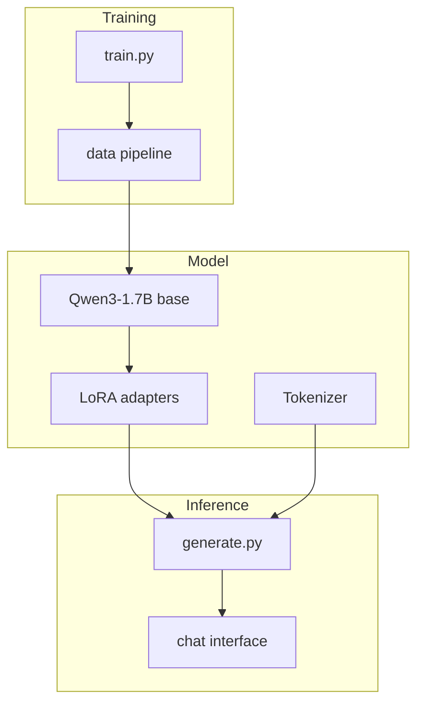

# Code Intelligence

Multi-layered code intelligence powered by 5 MCP servers (75+ tools).

## Status

| Layer | Status | Details |
|-------|--------|---------|
| **Structural Graph** | � Not indexed | Run `/cbm-init baligh` to build |
| **PR Review** | ✅ Ready | code-review-graph (34 tools) |
| **Multimodal Graph** | ✅ Ready | graphify (10 tools) |
| **Context Packing** | ✅ Ready | repomix (6 tools) |
| **Library Docs** | ✅ Ready | context7 (remote) |
| **Index mode** | `full` (all files + similarity/semantic edges) |
| **Watcher** | Auto re-indexes on git changes when enabled |

## Architecture



> Run `/cbm-init baligh` to generate the real diagram from graph data.

## How to index

```
codebase-memory-mcp index_repository --project baligh --repo_path D:/AI/Projects/Baligh
```

Or say **"Index this project"** in an OpenCode session.

## What it covers

The knowledge graph indexes:
- All Python source files (functions, classes, methods, decorators)
- Call graphs (who calls what)
- Import chains
- AST-level type resolution (Hybrid LSP for Python)

## Project-specific queries

| What you want | Query |
|---------------|-------|
| Find training scripts | `search_graph(project="baligh", name_pattern=".*train.*")` |
| Find data processing | `search_graph(project="baligh", name_pattern=".*preprocess.*\|.*tokenize.*")` |
| Trace model architecture | `trace_path(project="baligh", function_name="forward", direction="both")` |
| Dead code check | `search_graph(project="baligh", max_degree=0, exclude_entry_points=true)` |
| Architecture overview | `get_architecture(project="baligh")` |

## Agent tiers

| Tier | When to use | Tools |
|------|-------------|-------|
| **Scout** | Quick lookup, provisional | 7 tools, 3-4 calls max |
| **Verify** | Task-directed evidence | 11 tools, coverage checks |
| **Auditor** | Full bounded verification | All tools, complete pagination |

## Quick Reference

| Question | Tool call |
|----------|----------|
| Who calls X? | 	race_path(direction="inbound") |
| What does X call? | 	race_path(direction="outbound") |
| Find by pattern | search_graph(name_pattern="...") |
| Dead code | search_graph(max_degree=0, exclude_entry_points=true) |
| Impact of changes | detect_changes() |
| God nodes | graphify_god_nodes() |
| Pack for LLM | 
epomix_pack_codebase(path="...") |
| Architecture | get_architecture() |

## Agent tiers

| Tier | When to use | Tools |
|------|-------------|-------|
| **Scout** | Quick lookup, provisional | 7 graph + 6 repomix tools |
| **Verify** | Task-directed evidence | 15 graph + 10 graphify + coverage |
| **Auditor** | Full bounded verification | All 75+ tools |

## References

- [codebase-memory-mcp](https://github.com/DeusData/codebase-memory-mcp) — structural graph
- [Graph visualization UI](http://localhost:9749) — 3D interactive graph
- Say **"Index this project"** in OpenCode to build the graph